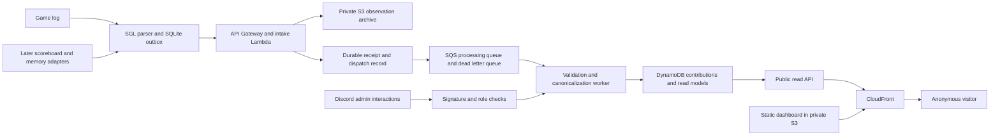

# SGL statistics design

Collect match observations in SGL, preserve them in AWS, and build a public dashboard with mode leaderboards, player totals and the latest ten matches per player or gamemode. Start with game logs. Add scoreboard or game-memory observations later without replacing match identities or redesigning player records.

This records the agreed design. The initial implementation is locally tested but has not been deployed to AWS; current backend status and operator instructions live in [SplitStatsInfra](https://github.com/SGLifers/SplitStatsInfra). One host submits each match. DynamoDB is the preferred baseline following the user's constraints: alias corrections are rare, public match lists contain only the latest ten per player or gamemode, and totals are calculated during indexing. The PostgreSQL comparison remains a cost/reference alternative, not a second backend to implement.

## Evidence and scope

Reviewed SGL at `2ed34bd1524c29b2c314b8508d2d7e9622d51951` and SplitgateHost statistics code and documentation on its main branch, whose latest commit was `29a2ae2c2ffd1cecb291dad8824cd536b45ae024` on 2026-11-23. SplitgateHost is the current behavioral reference. Detailed findings and source links are in [the source review](stats-source-review.md).

SplitgateHost is the accepted implementation reference. SplitStats and SplitStatsScoreboardReader are unavailable for direct review, and access is not a prerequisite for this work. SplitgateHost documents its own review of those projects at specific commits, including incompatible input schemas. Build SGL's collector and contract from the directly available evidence; do not assume access to, compatibility with or permission to copy the unavailable projects.

The first release includes log collection, durable local delivery, cloud ingestion, admin-managed Discord links and aliases, and a public dashboard for available metrics. Scoreboard capture/OCR and memory extraction are later collectors. Their metric names and provenance fit the initial model, but neither source is required for log-only ingestion.

## Repository ownership

Keep collection in SGL, the public frontend in [SplitStatsWeb](https://github.com/SGLifers/SplitStatsWeb), and the statistics backend/infrastructure in [SGLifers/SplitStatsInfra](https://github.com/SGLifers/SplitStatsInfra). These components have independent release cycles: a leaderboard or API change should not require a Windows app release, and a collector change should not redeploy the website. SplitStatsWeb remains frontend-only, including its existing tournament presentation.

| Repository | Proposed responsibility |
| --- | --- |
| `SGLifers/SGL` | Windows log collection, local SQLite checkpoints/outbox, future scoreboard/memory collection, sign-in integration, upload client and Hosting/Settings status |
| `SGLifers/SplitStatsWeb` | Public community/tournament UI, browser charts/tables, API client and frontend tests; preserves existing approved static tournament assets |
| `SGLifers/SplitStatsInfra` | Intake/read/admin APIs, DynamoDB indexer, identity/alias records, tournament import tooling, backend/hosting AWS infrastructure, service tests and authoritative versioned API contracts |
| `SGLifers/SGL-Discord-Bot` | Discord command registration and the thin command adapter to the statistics admin service, alongside existing announcements; exact integration requires review of that repository |

SplitStatsInfra backend repository layout:

```text
SplitStatsInfra/
  backend/              Intake/read/admin handlers, indexer and persistence
  infra/                Statistics API, DynamoDB, S3, queues and hosting
  contracts/            Versioned observation/API schemas and shared fixtures
  imports/tournaments/  Import tooling and manifests for approved public events
  tests/                Backend, contract, import and infrastructure validation
  docs/                 Service architecture, API and deployment instructions
```

SplitStatsWeb starts with its existing HTML/CSS/JavaScript rather than requiring a frontend framework migration. Extract reusable ranking/table/medal/scoreboard components as community views are added. Keep approved public tournament assets alongside the web build if appropriate; private raw logs, cloud archives and credentials never belong in a repository or site artifact. Backend services and AWS templates belong only in SplitStatsInfra.

SplitStatsInfra owns the wire contract, published as a versioned schema/fixture artifact. SGL pins a compatible version and validates its C# DTOs against those fixtures; SplitStatsWeb pins the public read contract. Do not introduce a runtime Git dependency or require matching desktop/backend/frontend releases. The API should accept supported older collector schema versions during upgrades. The canonical alias state remains in the statistics service regardless of where the Discord interaction adapter runs. Reuse the existing Discord application/interaction entry point if supported; do not configure two competing interaction URLs or deploy a second independent alias database.

The current SplitStatsWeb workflow uploads its repository root to GitHub Pages. Keeping backend/infra in SplitStatsInfra avoids adding those files to that artifact. As the frontend gains a build step, publish only its web output. The existing Pages site can continue serving the tournament during development; the intended unified hosting remains S3/CloudFront plus the AWS API. SplitStatsInfra provisions hosting resources and publishes backend releases; SplitStatsWeb builds and deploys only frontend assets to the agreed hosting destination, using its own scoped deployment identity. No source checkout should contain a copied frontend release. A repository split does not require an immediate hosting migration. No SplitStatsWeb files or deployments have been changed by this setup.

Backend architecture, cost and deployment documentation belong in SplitStatsInfra; frontend usage/build documentation belongs in SplitStatsWeb; SGL keeps collector integration notes and a cross-link to the backend contract. The design copies under SGL's `docs/` record the initial planning session and should not become a second independently maintained backend specification. The existing sharing stack continues to own the single account-wide budget; a separate statistics stack must not create a second account-wide budget or reset the planned $30 target.

## Existing tournament integration

Direct review of SplitStatsWeb at `79a643f04acb35518a485a7c959c3b8c0a53d2f2` found a static page for the **Super Sweats KOTH tournament on October 4, 2026**. Its committed `data.js` contains six matches, twelve team rows, forty-eight player-medal rows, 1,348 medal events and thirty-two scoreboard rows covering matches 1, 2, 3 and 5. Matches 4 and 6 have no scoreboard rows in that artifact. `scoreboards.csv` supplies the combat counters; the data builder combines them with an external workbook and applies named-winner and player-name overrides.

Serve two explicit sections in one public website:

- **Community stats:** the new live collection, player/gamemode totals and latest-ten match projections.
- **Tournaments:** curated event pages, beginning with the existing Super Sweats KOTH archive, preserving its teams, medals, match details and video links.

Use a stable event ID such as `super-sweats-koth-2026-10-04`. Initially the existing approved static dataset can keep serving the archive without a DynamoDB import. An idempotent import can later index it into the same cloud service under `scope=tournament#<event_id>` with `ingestionKind=tournament_import`, source commit/hash, stable event-local match IDs and an import revision. The import path is distinct from metric provenance: record which fields came from log/medal data, scoreboard CSV or curated overrides rather than labeling every field as log-derived or memory-derived.

Keep tournament rankings/totals separate from community totals by default. An optional future combined view requires explicit match deduplication and policy; importing the tournament and later observing the same match must not add it twice. Treat medal-event rows and player-medal aggregates as alternative representations to reconcile, not two additive inputs. Preserve approved winner/team overrides and record them as curated evidence. Convert existing special-case name mappings into reviewed identity links/aliases; do not apply their aggressive punctuation stripping or prefix matching globally. Unlinked tournament names can appear on the event page without creating an unverified Discord link.

Expose XP/kills/damage/deaths/hill values only for the four matches with scoreboard data, preserving missing values elsewhere. The tournament's displayed hill column is not independent verification of its physical unit; keep its original value/label until verified. The workbook referenced by `build_data.py` is outside the checked-in repository, so the committed generated dataset is the available archive artifact. Preserve it with a manifest/hash and make any new importer reproducible from supplied inputs instead of assuming a clean checkout can regenerate that workbook.

The latest-ten limit applies to the general community history APIs. Serving the existing six-match curated tournament archive is an explicit event-scoped publication; it does not open arbitrary older community matches. A public tournament API, if introduced, exposes only approved event projections and never accepts an unrestricted archive/source ID. This preserves the existing tournament experience while keeping the community-history restriction intact.

## What can be collected

| Data | Logs first | Scoreboard later | Important interpretation |
| --- | --- | --- | --- |
| Match and round lifecycle | SERVER/CLIENT experiences, intermissions, PostGame and outcome blocks | Title and final table corroboration | Intermissions and individual round outcomes do not each create a new match |
| Map | Logged map asset path | Displayed map title | Custom map identity/name may need SGL metadata; keep the original path |
| Gamemode | Some experience names identify a family | Observed title identifies supported layouts | `EXP_Deathmatch` alone cannot distinguish TDM, FFA and variants |
| Winners and draws | Outcome tags, reasons and winner labels | Possible corroboration | A round winner is not automatically the overall match winner |
| Team and player scores | Raw numeric outcome values | Mode-dependent score column | Raw experience scores are not kills, damage or XP |
| Medals | Timestamp, raw medal code and displayed recipient | Not needed | Preserve codes; translate labels through a versioned catalog |
| Participant names | Joins, scores, medals | Final visible rows | Preserve departed players and duplicate names |
| Join and leave observations | Successful joins and some correlated connection closes | Not available | Unknown departure time remains null; remote connection does not prove a human |
| Death-event diagnostics | Aggregate observed event count | Per-player deaths | Log events do not establish named deaths or kills |
| XP, kills, damage, deaths | Not established by the reviewed log parser | Supported layouts expose these columns | Not every layout has every column |
| Captures | Not established as a named stat | Domination and Splitball layouts | Keep mode semantics distinct even when labels match |
| Hill time | Not established | KOTH reader field | Reader calls it `hill_time_seconds`; the unit still needs verification |
| Score and placement | Raw outcome scores retained separately | Layout-dependent score; placement is an accepted adapter field | Placement availability is not established for every layout |
| Other memory stats | Deferred | Deferred | Register names, types, units and semantics before enabling totals or ranking |

Observed scoreboard column sets include:

- TDM, Takedown, Takedown Classic, Fiesta, Big Head Snipers, Team SWAT, Team Shotty Snipers and team One in the Chamber: XP, kills, damage, deaths.
- Domination and Splitball: those four columns plus captures.
- KOTH: those four columns plus hill time.
- FFA One in the Chamber: score, XP, kills, damage, deaths.
- Gun Game: score, XP, damage, deaths. There is no kills column in the observed layout.

Assists, accuracy, weapon statistics and other memory fields are not promised by this evidence. Unknown, unavailable, inapplicable, conflicted and actual zero are distinct states throughout storage and presentation.

## Collection in SGL

Add a statistics service under `SGL.Core`, with a small WPF status surface in Hosting and preferences under Settings. Keep collection and upload off the UI thread. Integrate with existing Discord sign-in; do not distribute AWS credentials or bot tokens in the desktop.

Proposed modules are `StatisticsLogReader`, `StatisticsParser`, `StatisticsLocalStore`, `StatisticsUploader` and a shared `StatisticObservation` contract. Future scoreboard and memory adapters emit that same contract. Do not require Python or a Docker OCR image for the first Windows log collector.

The default log location is `%LOCALAPPDATA%\PortalWars2\Saved\Logs\PortalWars2.log`, consistent with SplitgateHost's Proton path. Verify the Windows installation during the pilot and allow an explicitly selected alternate game log folder. Do not watch SGL's own logs or treat CloudSave files as match logs.

### File and parser lifecycle

1. Bind to the current game process identity, log file identity and durable source generation. A process ID alone is insufficient because it can be reused. File notifications wake the reader; periodic size checks handle missed notifications.
2. Read bounded byte chunks with shared access compatible with the game's writer. Validate continuity using file identity and committed prefix fingerprints. Detect truncation, replacement and interior rewrites, including truncate-and-regrow. Preserve Windows file identity through a handle rather than relying on a path or modification time alone.
3. Buffer incomplete UTF-8 and partial lines. Parse only complete lines, recognizing the actual timestamp and log category before matching event text. Chat quoting an event is not an event.
4. In one SQLite transaction, commit the byte cursor, partial bytes, parser state, newly observed facts and outbox entries. Use WAL, full synchronization, a single writer and per-user Windows file permissions. Store under `%LOCALAPPDATA%\SGL\Statistics`, independently of CloudSave history.
5. A SERVER gameplay experience opens a match; an intermission preserves it. Round outcome blocks attach to that match. A compatible PostGame transition closes it. Confirm recognized winner/draw tags and score blocks before marking it complete. Keep requested/manual ends, unexplained map transitions, process loss and interrupted streams incomplete unless sufficient validated evidence establishes completion.
6. SERVER-to-CLIENT changes mark authority loss. Stop leaderboard eligibility for that hosting epoch; retain evidence and require a fresh hosting epoch before accepting authoritative matches again. Starting SGL halfway through a match creates a partial observation, not a fabricated full match.
7. Seal a log observation at match close and queue immutable bytes for delivery. Log collection proceeds without waiting for a screenshot. Each later enrichment is a separate immutable observation linked to the same match.

Persist a random collector ID and generation manifest before reading, and reuse them after restart. The local match key is derived from collector ID, source generation and the first gameplay experience's byte offset. Cloud uniqueness is `(collector_id, source_generation_id, match_start_offset)`. An import must reuse its original manifest or be marked as a separate historical import for review; reinstalling and replaying the same log with new identities is not automatically deduplicated. No cross-host match election or similarity-based merge is needed under the single-submitting-host assumption.

Collect earlier lobby bytes when they are available to preserve join context. Do not upload raw login, peer, network-address or connection strings. Use session-scoped opaque correlation IDs locally and emit only sanitized observations. Preserve original log timestamps, clock/offset metadata and receipt time. Establish whether the Windows build's timestamps are UTC during the pilot; unresolved wall-clock times must not silently enter date-based rankings as UTC.

### Mode and rules context

Store `experience_raw`, mode family, variant, rules fingerprint and map identity separately, each with its evidence. SGL's spinner result, announcement text or the mode open in the editor is a host hint: none proves which mode or rules the game actually loaded. SGL currently does not control or verify game PLAY. Do not import SplitgateHost's verified-HUD authority claim into SGL without implementing equivalent evidence.

Resolve mode from an unambiguous experience, a later validated scoreboard/memory observation, or an explicit admin correction with provenance. Keep ambiguous matches in an Unknown mode group. Display custom and standard/competitive variants separately; an unknown rules fingerprint must not imply standard rules. No competitive skill rating is included in this design.

### Delivery and authentication

Use the existing SGL sign-in flow to request a short-lived statistics collector credential after server-side verification of guild membership and the configured host role/allowlist. Bind it to collector and guild IDs. It authenticates who submitted an observation; it cannot prove that an untrusted client reported true gameplay. Public ranked data comes from community-authorized collectors.

Use `observation_id` as the idempotency key and include a SHA-256 of the exact body. Retry network errors, 408/425/429 and 5xx with jitter and backoff; respect bounded `Retry-After`. Pause on 401/403 until sign-in/authorization is repaired. Surface permanent validation errors without looping. Never follow a credential-bearing redirect.

A 202 response means durably received, not parsed or published. Store the receipt, and track its subsequent `received`, `processing`, `published`, `needs_review` or `rejected` status. A lost response retries the same body and key. Same key/body returns the original receipt; same key/different body returns 409. Sign-out stops uploads; retained outbox entries remain bound to their original collector and actor and cannot upload under a different account silently.

## Domain model

Separate immutable source observations from the current interpretation and public aggregates. Discord IDs identify accounts; names identify aliases; match-local participant IDs identify rows. None is interchangeable.

| Entity | Essential fields and constraints |
| --- | --- |
| Guild | Community ID and policy/configuration version |
| Collector | UUID, submitting Discord account, guild, authorization status and credential generation |
| Source generation | UUID, collector, game process/file identity fingerprints, timestamps and clock metadata; private |
| Match | UUID, unique collector/source/start key, start/end, lifecycle state, authority, resolved mode/rules/map, eligibility reasons, canonical revision |
| Observation | UUID, match, source (`game_log`, `scoreboard`, `game_memory`, `admin`), source schema/parser version, source sequence/span, hash, receipt time and immutable payload reference |
| Round | Match plus stable ordinal; outcome tag, reason, winner labels, raw grouped and ungrouped scores, completeness |
| Participant | Match-local ID, raw displayed name, team observations, join epochs, explicit/unknown bot status and identity resolution state |
| Player | Stable internal UUID and public slug; optional Discord link; canonical display label |
| Discord link | Guild, Discord snowflake stored as a string, player UUID, latest username/nickname snapshots; unique active `(guild_id, discord_user_id)` |
| Alias | UUID, guild, exact observed spelling, normalized search key, player UUID, validity interval, status, normalization version and admin audit reference |
| Identity resolution | Participant ID, player UUID or null, alias/evidence IDs, method, ambiguity reason and revision |
| Metric definition | Stable key, semantic version, display name, number type, unit, scope, applicable modes, aggregation, direction and allowed source/quality policy |
| Metric observation | Observation and participant/team/match/round scope, metric key/version, value or null, value status, unit and quality evidence |
| Medal event | Observation/source position, match, raw medal code, recipient participant or unresolved name, timestamp; unique original event identity |
| Canonical metric | Scope, metric, chosen observation(s), resolution policy version, status/value and canonical revision |
| Match contribution | Canonical match/player/metric contribution, eligibility/coverage and revision; rebuildable |
| Aggregate | Player, mode/rules scope, period and metric; value, covered/eligible matches, source coverage, calculation version and build revision |
| Admin audit | Actor Discord ID, interaction ID, action, reason, before/after values, timestamp and affected scope; append-only |

Use finite numbers and explicit units. Integer counters cannot accept booleans, NaN, infinities or silently rounded fractions. Preserve fractional damage if supported. Store raw outcome score independently as `log.player_score`/`log.team_score`; register combat kills as `combat.kills`. A future metric with the same label but different meaning gets a different key/version.

For each metric, store one of `known`, `not_collected`, `not_applicable`, `ambiguous` or `conflicted`. Only `known` carries a numeric value. Store facts at their actual scope: a team score is not a player score, and a final match cumulative counter must not be added to all its round snapshots. Memory adapters must declare counter reset behavior and whether values are cumulative snapshots or deltas. Retain unknown future fields privately without automatically exposing or ranking them.

### Combining sources

Authority is metric-specific. Logs currently establish log outcome/medal facts; scoreboard or validated memory collectors can supply combat counters. There is no blanket rule that memory always wins. Initially keep any new memory metric observational until tested against known matches and assigned a policy.

Two observations of 12 kills describe the same fact, not 24 kills. A disagreeing 12/13 pair is preserved and marked conflicted unless a versioned, validated policy resolves it. Ingestion order never determines the answer. Late enrichment increments the canonical revision and replaces that match's derived contribution. Original observations and earlier published revisions remain auditable.

Adding an alias or correcting a source can therefore repair historical totals. Rebuild from observations and current identity resolutions; never edit old source names to make them match Discord.

## AWS pipeline



Use a separate statistics deployment and permission boundary alongside the sharing service. Reuse its sign-in/session verification and established deployment conventions. Do not put statistical event traffic in sharing's item/revision tables. Plan to raise the existing account-wide monthly budget from $10 to $30 for the statistics rollout; the statistics service retains its own $10/month planning allowance within that shared budget.

### Account budget plan

The repository now defaults `MonthlyBudgetUsd` to 30 in both [the deployment script](../sharing/infra/deploy.ps1) and [the CloudFormation template](../sharing/infra/template.json). This confirms the source default, not the deployed AWS value. The planned account-wide budget is **$30 USD/month**, covering sharing, statistics, bot services and any other billed resources/regions in the account. It is not a separate $30 statistics budget or a service quota increase.

Keep the existing actual-cost notification thresholds: 50%, 80% and 100%, corresponding to **$15, $24 and $30**. The template uses `GREATER_THAN`, so notifications are triggered after reported costs exceed each amount. At the 100% notification, retain the automatic pause and operator-controlled resume policy. AWS billing notification delays mean this remains a budget/control threshold, not an exact hard spending cap.

During implementation/deployment, verify the current live budget, update the existing budget to $30 through `MonthlyBudgetUsd`, and update source defaults/operator documentation together so a later deployment cannot silently revert to $10. Reuse the existing account budget and notification channel rather than introducing independent account-wide budgets in each service stack. Verify the monitored recipient, notification subscriptions and guard status after the change; preserve any existing pause until an operator explicitly resumes it.

The current guard pauses sharing resources only. The statistics rollout must extend coordinated pause/reconciliation/resume coverage to statistics intake, indexing/background work and public API/delivery controls as applicable, retaining queued observations and local outboxes. Stop queue consumption while processing is paused rather than repeatedly failing messages into the dead letter queue. Storage, backups, monitoring, already cached delivery and unrelated workloads can still incur costs. Statistics pause/reconciliation/resume controls are now implemented in SplitStatsInfra and remain undeployed. Source changes do not change the live AWS account.

The intake Lambda validates bounded payloads and collector authorization, conditionally writes a content-hashed immutable S3 object, then atomically records the receipt and a dispatch item. Receipt storage can be a small DynamoDB table in either database option. Dispatch through its stream with retries; a scheduled reconciler requeues dispatches that were not confirmed. The worker and reconciler tolerate duplicates. Return 202 only after the archive and receipt/dispatch are durable. Orphan S3 objects created before a failed receipt write are harmless and swept after a grace period.

SQS delivery is at least once and may be out of order. Workers use database uniqueness/version checks, not queue deduplication windows, to prevent duplicate contributions. An enrichment arriving before its base observation remains pending and is reconsidered when dependencies arrive. Record permanent validation failures and quarantine them; send repeatedly failing operational work to the dead letter queue. A worker writes final receipt status after database commit; a crash in between replays idempotently and repairs the receipt.

CloudFront serves the static dashboard and caches anonymous API GETs. The public API role reads only approved public projections; private canonical observations and contributions are available to indexing/admin jobs, and archive buckets stay private. Private diagnostic evidence retention starts at 90 days as a proposed operational setting, subject to the community's policy; retain sanitized observations needed to rebuild public totals for the retained statistical history. Do not promise indefinite reparsing from raw logs when raw logs remain local. Configure backups, recovery drills and bounded public queries.

### PostgreSQL comparison alternative

Use private RDS PostgreSQL, with separate ingestion and read database roles. Small Lambda connection pools and bounded worker concurrency can be sufficient initially; RDS Proxy is optional and adds cost. Confirm actual regional instance, storage and backup prices before choosing a size or an availability configuration. Aurora Serverless is an alternative to price separately, not a promise of zero idle cost.

Relational tables follow the domain model. Use unique indexes on source match keys, observation IDs and active guild/Discord links. Use `timestamptz` for resolved times, JSONB for extensible raw source records, and typed numeric metric facts for aggregations. An exclusion constraint or serialized alias transaction prevents overlapping ownership of the same normalized alias and validity period. Index player/match history by `(player_id, ended_at DESC, match_id)` and facts by mode/rules, completion time and metric.

Commit observation registration, canonical revision, changed match contributions and durable rebuild jobs in one transaction. Serialize changes per match. Calculate MVP totals directly from current eligible contributions with indexed queries; add summary tables for hot leaderboard scopes when measurement justifies them. Derived summary updates are idempotent by contribution revision. A simple query path is an advantage here: an alias repair need not reverse a long chain of increment-only counters.

VPC Lambdas require explicit network design. Keep Discord/OAuth calls in a non-VPC front end and send authorized commands through the queue. Database workers/readers remain private. Price the AWS service endpoints or NAT access they actually need; neither should be silently assumed free. IAM database authentication can avoid fetching a secret for every connection; enforce TLS and least-privilege database roles.

### Preferred DynamoDB design

Use on-demand DynamoDB for canonical matches, identity records, private contributions and precomputed read models, plus S3 for larger source payloads. This follows the existing sharing service's Lambda/S3/DynamoDB model and avoids a continuously running database or VPC. Keep each item below the 400 KB item limit; medals/rounds are separate items or chunked archive records, never an unbounded match item. The public API reads only totals, rankings and recent-match projections. It cannot read the historical contribution/archive collections.

Design access patterns before table keys. The following is a proposed logical mapping; collections can be separated into physical tables for permissions and recovery:

| Access pattern | Key or index shape |
| --- | --- |
| Match details, participants and rounds | `PK=MATCH#id`, `SK=META`, `PARTICIPANT#id`, `ROUND#ordinal`, `METRIC#scope#key` |
| Observation metadata and dependency state | `PK=MATCH#id`, `SK=OBS#id`; payload in S3 |
| Stable source-to-match uniqueness | Conditional claim `PK=SOURCE#collector#generation`, `SK=START#offset` |
| Player and Discord lookup | `PK=PLAYER#id/SK=META`; conditional `DISCORD#guild#snowflake` claim |
| Exact alias resolution | `PK=ALIAS#guild#normalized_hash`, validity-versioned `SK`; transactionally maintain a single revision/lock item for overlap checks |
| Private player contributions | `PK=CONTRIBUTIONS#player#scope`, `SK=ended_at#match_id`; current canonical revision and compatible metric values for repair/reindex jobs |
| Private name lookup for alias repairs | `PK=OBSERVEDNAME#guild#normalized_hash`, `SK=ended_at#match_id#participant_id`; preserve exact spelling and ambiguous/unresolved status |
| Public player recent matches | `PK=PUBLIC#PLAYER#id`, `SK=RECENT#build#ended_at#match_id`; only the newest ten sanitized summaries in the active build |
| Public gamemode recent matches | `PK=PUBLIC#MODE#mode`, `SK=RECENT#build#ended_at#match_id`; only the newest ten sanitized summaries in the active build |
| Leaderboards | Partition by guild, mode/rules scope, period, metric, policy version and build generation; ordered score index plus stable player-ID tie order |
| Player aggregate lookup | `PK=PUBLIC#PLAYER#id`, `SK=TOTALS#scope#build`; bounded metric map with totals, denominators and coverage |
| Search | Bounded normalized name-prefix index; no table scan for substring search |

Do not perform cross-match scans or joins for dashboard requests. MVP totals cover all collected history, globally where metrics are compatible and by gamemode/rules scope. The latest-ten limit applies to public match access, not to the history included in totals. Calendar/season/rolling-period leaderboards are optional later projections; arbitrary date-range filters and public historical match pagination are outside the MVP. If rolling periods are added, scheduled expiration must remove contributions leaving each window.

#### Indexing and recalculation

An indexing Lambda calculates materialized totals and recent lists when canonical match data changes. A DynamoDB GSI only locates/sorts records; it does not calculate `SUM`, ratios or cross-match statistics automatically. Keep calculation logic in the indexer and make it replayable.

For normal ingestion or late enrichment, calculate the replacement contribution for each affected player/scope. Recalculate additive totals as `current total - previously applied contribution + replacement contribution`, with covered/eligible match counts and ratio numerators/denominators updated the same way. Assign a monotonic contribution revision whenever its canonical match, identity resolution or calculation policy changes. Commit that applied revision and the scope's aggregate under conditional version checks in one bounded transaction. An identical revision is a no-op, an older revision is ignored, and a concurrent update retries from the current state. There is no unguarded increment that a retry can apply twice. Nonadditive metrics such as a historical maximum require their registered recomputation policy when the old maximum is corrected; do not subtract maxima as if they were sums.

Only changed player totals/leaderboard rows and touched recent lists become dirty. Coalesce their publication into immutable read-model generations, then switch the active-generation pointer after the complete affected build is ready. No full-community/full-history rebuild is needed for each match. Rebuild a player/scope from its private current contribution records for rare alias corrections, parser/policy changes or repair. The private observed-name lookup identifies historical observations affected by a new alias, including previously unresolved names. Re-resolve those observations before recomputing old/new player totals, rankings and recent membership.

For complete-board publication, rebuild only a dirty mode/metric leaderboard snapshot from its precomputed player totals, writing the sorted snapshot privately to S3 and its active pointer to DynamoDB. Reading the other players' totals to sort that small board does not scan their match histories or rewrite every player's DynamoDB aggregate. A snapshot may contain more than ten ranked players: the ten-match constraint is separate from leaderboard size. The API serves the approved projection without returning archive object URLs.

An alias correction can make a previously hidden eleventh or older match become one of a player's newest ten. Retain private time-ordered membership/contributions so the indexer can refill the public list correctly. Do not recalculate historical totals from the ten public summaries, and do not delete canonical history when a summary drops out of that list. Non-submitted/partial player observations remain available privately for applicable recent-history policy even if they have no ranked metric contribution.

Rebuilds run in bounded jobs with checkpoints. Capture a source/aggregate version, and publish only if that version still matches; otherwise rerun the dirty scope. Index new events while repairs are queued, retaining the previous published generation until its replacement is consistent. Publish within a proposed five-minute freshness target. Keep old generations privately until leaderboard cursors and caches expire; old recent-match generations are not publicly addressable.

Break large builds into bounded jobs; DynamoDB transactions are limited to 100 actions and 4 MB. An alias repair touching years of history is not one transaction. Stage participant resolutions/history under a projection generation, then expose it when its affected read models are complete. Pin API responses to an active build and show a rebuilding state until they converge. GSI reads are eventually consistent: publishing a pointer does not make new index rows instantly complete. Use base-table reads for the small active recent lists; use a validated index build or an immutable sorted leaderboard snapshot and pointer for complete-board publication. Return `dataRevision` and `computedAt` and tolerate bounded staleness in normal reads.

### Storage tradeoffs

| Concern | PostgreSQL | DynamoDB |
| --- | --- | --- |
| Idle cost | Database compute/storage persist between matches; backups and optional proxy add cost | On-demand request/storage charges; no running database instance, but backups, queues and other AWS resources still cost money |
| Current SGL fit | Adds database operations and private networking | Reuses the existing serverless operational pattern |
| Leaderboards | SQL grouping, ordering and indexes; summaries optional | Fast bounded queries after read models are built |
| New filters and analytics | Flexible joins and date filters, subject to query budgets/indexes | Each new query shape may need a new index/projection or an offline job |
| Discord aliases and historical corrections | Natural joins, constraints and transactions | Uniqueness claims, asynchronous repair jobs and versioned projections |
| Additional memory metrics | Metric registry plus facts; new aggregations often SQL-only | Registry remains easy; making a new metric rankable needs its projection |
| Consistency | One transaction can publish related relational changes | Strong item/base-table reads available; GSIs and multi-item projections need explicit consistency handling |
| Scale and traffic bursts | Pooling, connection limits, query tuning and instance capacity | Automatic request scaling; hot keys/index design and rebuild cost need attention |
| Application complexity | Simpler data exploration and corrections; more database operations | Less infrastructure; more application code for aggregates and corrections |

With rare alias corrections, totals calculated during indexing and public match lists capped at ten per player or gamemode, DynamoDB is the recommended baseline. These bounded access patterns remove the principal reason to pay for flexible relational queries. PostgreSQL remains relevant if requirements later expand into arbitrary historical queries. A single submitting host removes cross-host reconciliation work in both designs; it does not remove retry idempotency or revision-aware recalculation.

Build the DynamoDB path, retaining the observation contract and archive for rebuild/migration. Before implementation, validate monthly matches, participants/medals per match, dashboard visits, retention and expected indexer work against the cost model. The existing sharing budget is account-wide and cannot be used as a dedicated statistics spending cap.

The [priced AWS comparison](stats-costs.md) uses current Oregon list prices: an efficient small deployment projects to approximately $3–7/month with DynamoDB, $16–20/month with the smallest Single-AZ RDS PostgreSQL instance, or $28–32/month with a roomier small instance. These are workload-based estimates, not observed bills or capacity guarantees. The comparison includes database arithmetic, common service allowances, higher-usage sensitivity and optional infrastructure charges.

For illustration, 20 matches/day for 30 days, 12 participants/match and 100 medals/match produce 600 matches, 7,200 participant-match records and 60,000 medal events per month before enrichment. These are sizing assumptions, not observed community usage. Both databases handle that scale comfortably. With 50 ranked players, eight future metrics, five period scopes and mode-plus-global boards, rebuilding all 4,000 affected aggregate rows after every match would create 2.4 million row writes/month before indexes, retries and expiry rebuilds. Rebuild only dirty scopes, coalesce work and cache reads. The example explains why DynamoDB's ingestion volume alone is an incomplete cost estimate; it does not estimate billed request units, which also depend on item size, transactions and indexes. PostgreSQL's cost at this scale is likely dominated by its chosen running configuration rather than row count. Use current [RDS](https://aws.amazon.com/rds/postgresql/pricing/), [DynamoDB](https://aws.amazon.com/dynamodb/pricing/) and [AWS calculator](https://calculator.aws/) prices for the selected region before setting a dollar target.

## Discord identity administration

Bootstrap internal player IDs and links from an admin-reviewed mapping of Discord account IDs to exact in-game names. Usernames and server nicknames can change; the Discord snowflake remains the link. Similar names provide suggestions for admins, never automatic account assignment.

Store exact original spelling. Use versioned Unicode NFC plus case folding and outer-whitespace trimming for lookup; do not remove punctuation, collapse internal spaces, strip clan tags, map OCR confusables or transliterate accents automatically. A normalization collision remains ambiguous even if the spellings look similar. Retain the ability to make explicit case-sensitive/participant-specific resolutions.

Resolve names using the alias's guild and effective time. Overlapping claims for different players are rejected. Duplicate same-name participants in a match remain unlinked unless additional stable evidence or an admin participant-specific resolution disambiguates them; an alias must not collapse multiple bot/human rows. Leaving the Discord server does not erase historical stats. If future memory yields stable game account IDs, add provider-account links and preserve the alias audit trail.

Proposed guild-only slash commands:

| Command | Effect |
| --- | --- |
| `/stats link member:@user game-name:"Name" effective-from:... reason:...` | Create/find a stable player and link the Discord account plus its initial alias |
| `/stats alias-add member:@user game-name:"Other Name" effective-from:... reason:...` | Add another spelling, checking conflicts and reporting historical matches that need repair |
| `/stats alias-remove member:@user game-name:"Name" effective-to:... reason:...` | Retire an alias; preserve historical ownership and audit records |
| `/stats aliases member:@user` | List exact aliases and validity intervals privately |
| `/stats unresolved name:...` | Inspect ambiguous/unlinked participant observations and suggestions |
| `/stats resolve match:... participant:... member:@user reason:...` | Repair one participant when a general name rule is insufficient |
| `/stats job id:...` | Inspect a mapping/import/rebuild job and its affected history |

Alias additions backfill unambiguous matching history by default, as recorded in [the backend implementation readiness notes](https://github.com/SGLifers/SplitStatsInfra/blob/main/docs/implementation-readiness.md). Support explicit effective dates and report the affected history before queuing a repair. Bootstrap/import can explicitly choose the earliest retained date for historical coverage. Provide an operator-only reviewed CSV import for the initial bulk mapping, with a dry run showing collisions before submission. Prevent linking one Discord account to two active player records. Merges and splits need explicit audited correction jobs, not an alias-add shortcut.

Verify Discord's Ed25519 signature against the exact raw body and timestamp, handle PING, reject stale/replayed interactions, enforce the configured guild and current stats-admin role/allowlist server-side, and deduplicate by interaction ID. Restrict command visibility as well, but do not rely on Discord UI visibility as authorization. Commands return an ephemeral deferred response within Discord's deadline, then an ephemeral result/job receipt. Long backfills use the durable job ID; do not rely on a long-lived interaction token. Use an HTTP interactions endpoint without an always-on Gateway connection. Extending SGL-Discord-Bot needs a separate review of that repository's current contracts.

An identity command creates an audit entry and a durable correction job atomically. During rebuild, show the previous consistent data revision with a freshness notice. Alias retirement preserves historical stats; correcting a wrongly attributed past interval recomputes the affected old and new player histories and leaderboard positions.

## Public API

No Discord login is required to view the dashboard. Public responses use opaque player IDs, display labels and approved public aliases. Discord account IDs, email, roles, network/session identifiers, raw logs and private audit records are excluded. An in-game name plus a Discord display label satisfies public attribution without exposing every Discord identifier.

| Endpoint | Contract |
| --- | --- |
| `GET /v1/stats/metrics` | Definitions, units, available sources, applicable modes and ranking eligibility; includes future/unavailable labels |
| `GET /v1/stats/modes` | Mode families, variants/rules scopes, map metadata and coverage |
| `GET /v1/stats/leaderboards?mode=...&rules=...&metric=...` | All-time ordered rows, ties, eligibility threshold, coverage and cursor |
| `GET /v1/stats/players?prefix=...` | Bounded player search across display labels and public aliases |
| `GET /v1/stats/players/{id}` | Canonical display profile, totals by requested scope and metric coverage |
| `GET /v1/stats/players/{id}/matches` | At most the latest ten matches for that player, with sanitized metrics and available detail; no history cursor |
| `GET /v1/stats/modes/{id}/matches` | At most the latest ten matches for that gamemode, with sanitized summaries and available detail; no history cursor |
| `GET /v1/stats/tournaments` | Approved public event metadata; the existing tournament can remain static initially |
| `GET /v1/stats/tournaments/{id}` | Optional cloud-backed curated event projection, rankings and approved match data; separate from community history |
| `POST /v1/stats/observations` | Collector-authenticated bounded immutable observation intake; returns receipt and status URL |
| `GET /v1/stats/receipts/{id}` | Collector/admin-only processing status; no public evidence access |
| `POST /v1/stats/discord/interactions` | Signed Discord commands, independently authorized |

Leaderboard/player-search pagination defaults to 25, maximum 100, with opaque validated cursors bound to filters and data revision. Leaderboard ties share rank; player ID gives deterministic pagination. Community match lists always return at most ten entries, sorted by end time then match ID, with no older-page cursor, date offset, arbitrary historical filters or caller-selected build. There is no standalone public community match-by-ID/history endpoint. Return enough bounded detail inside the recent projection for the UI; a future community detail endpoint must recheck current recent-list membership rather than treating possession of a match ID as access. Curated tournament projections expose only the approved event's published data as described above.

Publish `dataRevision`, `computedAt`, `coverage` and quality reasons. Unsupported metric/mode combinations return a clear unavailable state, not an empty all-zero ranking. Rate-limit and cache bounded reads. MVP totals/leaderboards are all-time since collection began, within the configured mode/rules scopes. Historical aggregate periods can be added explicitly later without exposing their underlying matches. Public cache TTLs bound the short delay before an entry rolling out of the newest ten disappears; do not expose old projection URLs or allow leaderboard cursors to reopen old recent-match lists.

Example proposed log observation envelope; these are illustrative IDs, not a compatibility claim for SplitStats schema 4:

```json
{
  "schemaVersion": 1,
  "observationId": "obs-example-001",
  "matchKey": {
    "collectorId": "collector-example",
    "sourceGenerationId": "generation-example",
    "matchStartOffset": 1024
  },
  "source": "game_log",
  "parserVersion": "sgl-log-1",
  "sourceSpan": { "startOffset": 1024, "endOffset": 8192 },
  "completion": "complete",
  "authority": "server",
  "mode": { "family": "domination", "evidence": "experience" },
  "participants": [{ "id": "p1", "displayName": "Example Player" }],
  "rounds": [{
    "ordinal": 1,
    "outcome": "Experience.Outcome.Winner",
    "winners": [{ "teamLabel": "Team_0" }],
    "scores": [{ "scope": "team", "teamLabel": "Team_0", "value": 100 }]
  }],
  "medals": [{
    "sourceOffset": 2048,
    "code": "MD_Defender",
    "participantId": "p1"
  }]
}
```

The production schema also requires source timestamps/clock metadata, sizes/hashes and parser limits. Later adapters use their own source schema versions; do not reuse the scoreboard reader's image schema number as the cloud result schema. Compatibility with an external receiver, if needed later, requires an explicit adapter validated against that receiver's documented contract.

## Dashboard design

The dashboard has Community and Tournaments navigation. Community has leaderboard/gamemode and player views, with expandable match detail from their latest-ten lists; Tournaments preserves curated event pages. Use a responsive table as the precise value view, accompanied by charts where comparison or change is clearer visually. Deep links preserve the selected mode, metric and rules scope. A community match link is scoped to its player or gamemode and only resolves while that match remains in the scope's newest ten.

| View | Layout and behavior |
| --- | --- |
| Leaderboards and gamemode | Mode/rules and metric selectors; top-player horizontal bars with a zero baseline; ranked table with player, value, covered matches and coverage; gamemode's latest ten matches; click a player to open their profile |
| Player | In-game display name and linked Discord display label; collected-history totals; per-mode breakdown; latest ten matches with map/mode, date, available result, medals/stats and source status; optional trend limited to those ten matches |
| Recent match detail | Expand a current recent entry to see mode/map/time, completion, available participant/scoreboard/round/medal detail and source coverage; no historical match browser |
| Tournament | Event title/date, named teams, event rankings, approved match details, medal breakdowns and existing video links; preserve missing-scoreboard coverage and separate event scope |

Conceptual desktop layout:

```text
SGL Stats                                      Player search
Leaderboards
[Mode] [Rules or variant] [Metric]                Updated 2m ago

Top players                         Rankings
Player A  =================  42     Rank  Player    Medals  Coverage
Player B  ============       31       1    Player A    42    12/12
Player C  ========           22       2    Player B    31     9/10

Player A  >  Domination  >  All collected history
Medals 42       Recorded matches 12       Kills — Not collected
[Last-ten-match trend]               [Mode breakdown]
Latest 10 matches: date / mode / map / medals / result / coverage
```

Initial log-backed rankings can show medals and recorded match participation by resolved player/mode. Label participation as "Recorded matches": a name appearing in medals/scores does not establish that the player completed the entire match, and host/bot/late-join roster coverage can be incomplete. Match and round counts are not interchangeable.

Show round wins only where a player/team relationship is established. Enable match wins and win rate only after the collector establishes a final match outcome and the player's relevant team/participation. Never infer lifetime wins from the first winner label or count every Takedown round as a match win. Keep raw log scores in match details, not a cross-mode leaderboard.

Kills and other registered future metrics appear as "Not collected yet" with a short explanation. Their leaderboard controls stay unavailable until actual data exists for that mode. Once enriched, show coverage such as "Kills from 8 of 12 eligible matches". Do not treat four missing matches as zero. Line charts leave gaps for unknown data; cumulative totals are labeled as observed totals when history is incomplete. Do not label missing pre-collection history as lifetime totals.

Totals sum known compatible contributions. K/D uses `sum(kills) / sum(deaths)` from matches in which both are known; do not average match K/D values. Zero deaths displays the numerator and "0 deaths" rather than an invented finite ratio. Win rate uses only resolved eligible match outcomes. A provisional default for ratio leaderboards is at least ten qualifying matches, visible in the UI and configurable by policy; raw totals have no such minimum. Hill time cannot be displayed as seconds until the unit is validated. Score is comparable only within a mode/rules scope whose score semantics are registered.

Default rankings exclude incomplete, authority-lost, conflicted and explicitly ineligible matches; unresolved identities and known bots do not gain a personal leaderboard entry. An admin-approved name alias remains a name-based association, not proof of a game account or human identity. Preserve unknown bot status and disclose roster coverage rather than claiming perfect human-only detection from logs. All-mode views use only metrics with compatible semantics, and retain variant/rules filters to avoid mixing arbitrary custom scoring with standard matches.

Use text and symbols alongside color for completion/source labels. Charts need keyboard-accessible labels and a table equivalent. At mobile widths, stack bars and rankings and prioritize player/value/coverage columns. Include loading, empty history, unknown mode, partial source, API failure and rebuilding states. A stale cached board retains its update time rather than appearing live.

## Implementation order and acceptance

1. **Validate the SGL contract and DynamoDB access patterns.** Use SplitgateHost as the collection reference; confirm actual Windows encoding/timestamps and source semantics with sanitized host logs. Establish SplitStatsInfra's backend/infra/contracts ownership and independent builds while keeping SplitStatsWeb frontend-only and preserving its tournament page. Validate later scoreboard headers/units independently, and check permissions before reusing implementation code. Confirm private contribution retention, all-time materialized totals and the latest-ten public projections against the cost model. Access to the two unavailable reference repositories is not required.
2. **Build local log collection.** Add background parsing, SQLite checkpoints/outbox and Hosting status. Replay whole and byte-fragmented fixtures into identical results. Exercise restart, partial UTF-8, multi-round modes, duplicated names, missing outcome, ambiguous Deathmatch, quoted chat, process/file replacement, host migration and manual stop. Verify collection cannot change game saves or block UI actions.
3. **Build cloud ingest and queries.** Provision through versioned infrastructure, raise the existing account-wide budget to $30 as planned, and extend/test coordinated budget controls for the statistics resources. Validate payload limits and least-privilege roles, and demonstrate duplicate/lost-ack retry with one effective contribution. Exercise out-of-order enrichment and crash after each persistence boundary. Show received versus published status, queue retry/DLQ/reconciliation and full rebuild from retained observations. Restore a backup in an isolated environment.
4. **Bootstrap Discord mappings.** Dry-run the admin mapping import, then link approved names. Verify wrong guild/role/signature/replay rejection, collision handling, renamed Discord accounts, same-name participants and alias effective dates. Correct a deliberately mislinked player and verify both histories and every affected ranking converge under a new revision.
5. **Release the public log dashboard.** Check totals against known fixtures, match/round distinction, missing-versus-zero behavior, no fabricated kills/wins, bot/unresolved handling, leaderboard pagination/ties/date boundaries, anonymous read access and absence of private identifiers. Ingest at least eleven matches per player/gamemode: verify only the latest ten are accessible, all eligible matches still count toward totals, late arrivals sort by match time, and an alias repair correctly refills recent membership from private history. Verify older-match IDs, filters and stale projection parameters cannot retrieve historical community matches. Preserve the tournament's six approved matches, medal totals, named winners and video links, with scoreboard data only for matches 1/2/3/5. If importing it, verify repeat imports have no duplicate effects and event/community scopes remain separate. Pilot with one real submitting host and compare published data to the original local logs.
6. **Add scoreboard or memory enrichment.** Keep the same match and participant identifiers. Validate field scopes, completeness, units, reset semantics and identity evidence; add metric policies only after measured agreement. Reprocess an old match with a new observation and verify its totals change once. Preserve contradictory source facts for review.

Proposed pilot targets are publication within five minutes of match close for DynamoDB read models and successful local resume after a 24-hour network outage. These are acceptance goals, not measured service guarantees. Monitor queue age, receipt-to-publication delay, unresolved identities, unknown modes, parser errors, dead letters, rebuild lag and query cost. Alert on operational counts without placing raw player/game/network data in routine logs.
